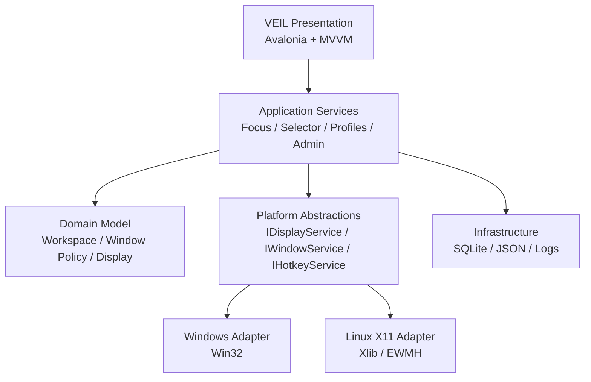
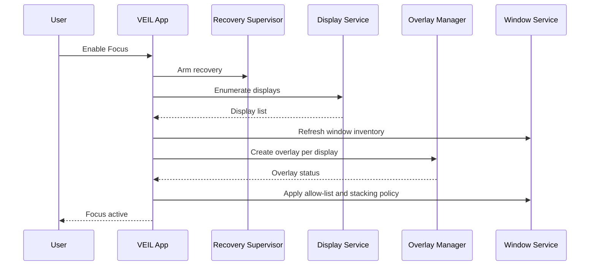

# 03 — Software Architecture

## 1. Architecture goals

- Keep business rules and workspace policy platform-independent.
- Isolate OS-specific display, window, stacking, and hotkey operations.
- Make overlay lifecycle observable, reversible, and safe.
- Support Windows and Ubuntu X11 in 1.0.
- Keep Wayland as a future adapter rather than leaking X11 assumptions into core logic.

## 2. Recommended technology baseline

| Area | Recommendation |
|---|---|
| Language/runtime | C# / .NET LTS selected at implementation kickoff |
| UI | Avalonia UI, MVVM |
| Architecture | Clean Architecture / Ports and Adapters |
| Local data | SQLite for structured state; JSON for export/import |
| Logging | Structured local logging with rolling files |
| Windows integration | Win32 APIs through a Windows platform adapter |
| Linux integration | X11/EWMH APIs through a Linux X11 adapter |
| Packaging | MSIX or signed installer on Windows; deb/AppImage evaluation on Ubuntu |
| Tests | xUnit plus platform integration tests |

Exact .NET target and Avalonia version must be pinned in the repository before coding. Avoid preview runtimes for release builds.

## 3. Logical architecture



## 4. Solution/project structure

- `VEIL.App`: composition root, startup, dependency injection, application lifetime.
- `VEIL.Presentation`: Avalonia views, view models, theme, assets.
- `VEIL.Application`: use cases and orchestration.
- `VEIL.Domain`: entities, value objects, policies, state machine.
- `VEIL.Infrastructure`: SQLite repositories, JSON import/export, logging.
- `VEIL.Platform.Abstractions`: interfaces and normalized platform models.
- `VEIL.Platform.Windows`: Win32 implementation.
- `VEIL.Platform.Linux.X11`: X11/EWMH implementation.

## 5. Core components

### 5.1 Display Manager
Responsibilities:
- Enumerate active displays.
- Normalize bounds, scale factor, orientation, primary flag.
- Subscribe to topology changes.
- Create/remove per-display overlay surfaces through presentation/platform coordination.

Interface sketch:
```csharp
public interface IDisplayService
{
    IReadOnlyList<DisplayInfo> GetDisplays();
    event EventHandler<DisplayTopologyChangedEventArgs> TopologyChanged;
}
```

### 5.2 Overlay Manager
Responsibilities:
- Create one overlay per active display.
- Coordinate z-order policy with the platform window service.
- Ensure teardown is idempotent.
- Track overlay health per display.
- Never create an overlay before recovery hooks are ready.

### 5.3 Window Manager
Responsibilities:
- Enumerate eligible top-level windows.
- Track process identity, window handle/token, title, bounds, display, visibility, minimized state.
- Activate, raise, position, and hide windows where supported.
- Avoid relying on title text as a stable identifier.
- Detect stale handles and process exit.

Normalized model:
```csharp
public sealed record WindowInfo(
    string RuntimeId,
    string ProcessId,
    string ApplicationId,
    string Title,
    string DisplayId,
    WindowBounds Bounds,
    bool IsVisible,
    bool IsMinimized,
    bool IsAllowed);
```

`RuntimeId` is session-scoped and must not be persisted as a durable identity. Use application identity (executable path/package identity) for policy matching.

### 5.4 Application Policy Manager
- Match windows to allow-list entries.
- Define explicit rules for modal/child windows.
- Default unknown transient windows to hidden.
- Allow policy updates only through authorized admin use cases.
- Keep policy evaluation separate from OS window enumeration.

### 5.5 Window Selector
- Query current window inventory.
- Present allowed and hidden status.
- Request reveal/hide actions through application services.
- Refresh safely when windows open/close.
- Support keyboard navigation.

### 5.6 Hotkey Manager
- Register platform-specific shortcuts.
- Detect conflicts.
- Route shortcuts to application commands.
- Keep emergency recovery registration independent from selector UI.

### 5.7 Admin Manager
- Ask the platform authentication provider to verify the current OS identity.
- Compare verified identity with the single configured Super Admin identity.
- Do not collect or store OS passwords.
- Require OS administrator authority for initial provisioning and reassignment.
- Apply protected machine-wide configuration permissions.

### 5.8 Recovery Supervisor
- Own emergency teardown.
- Register process-exit and shutdown handlers.
- Provide a watchdog/recovery strategy where practical.
- Ensure overlay windows do not outlive the owning process.
- Record failure diagnostics without blocking teardown.

## 6. Platform adapter strategy

### Windows
Use Win32 APIs for:
- Display enumeration and topology notifications.
- Top-level window enumeration.
- Window activation and positioning.
- Global hotkey registration.
- Process and executable identity lookup.
- OS identity/token inspection and supported authentication flow.

Important constraints:
- Windows secure desktop, UAC secure prompts, lock screen, and certain protected windows are not controlled by ordinary desktop overlays.
- `SetWindowPos` and topmost behavior must be tested against fullscreen, exclusive fullscreen, elevated, and multi-process applications.
- Do not attempt to suppress Ctrl+Alt+Del or bypass secure attention sequences.
- Window handles are transient and must be validated before use.

### Ubuntu X11
Use X11/EWMH conventions for:
- Display discovery (RandR).
- Window enumeration and metadata.
- Window activation/stacking where permitted by the window manager.
- Global shortcuts through a tested desktop integration strategy.
- Current session and user identity detection.

Important constraints:
- EWMH behavior varies by window manager.
- X11 does not guarantee identical behavior across all desktop environments.
- Do not assume every window manager honors every stacking request.
- Test GNOME on Xorg as the primary reference environment.

### Wayland
Not part of full 1.0 support. Wayland compositors intentionally restrict arbitrary cross-client window enumeration and manipulation. A future adapter may use compositor-specific protocols or desktop portals, but must not claim parity until tested.

## 7. Overlay and window stacking model

Conceptual order, bottom to top:
1. Desktop and ordinary background windows.
2. VEIL overlay surfaces.
3. Explicitly permitted work windows.
4. VEIL transient controls such as selector, when required.

The exact stacking strategy is platform-specific. The architecture must not assume that a single global topmost flag behaves identically on both platforms.

When multiple allowed windows are visible, VEIL should preserve normal interaction among those windows while ensuring the overlay remains behind them and above the ordinary desktop. This behavior requires platform integration tests.

## 8. Data model

Core entities:
- `SuperAdminIdentity`: one machine-scoped OS identity reference.
- `ApplicationRule`: stable application identifier, display name, enabled flag, transient-window policy.
- `WorkspaceProfile`: profile name, app rules, theme, optional layout.
- `DisplayPreference`: stable display hints, not raw transient display indices.
- `HotkeyBinding`: command, key combination, enabled flag.
- `FocusPreferences`: start behavior, overlay appearance, recovery options.
- `AuditEvent`: timestamp, OS identity, action, result.

Do not store passwords, authentication tokens, or unnecessary window content.

## 9. Persistence

- SQLite: profiles, application rules, hotkey bindings, preferences, audit metadata.
- JSON: portable configuration backup/export.
- Machine-wide protected configuration: stored under OS-appropriate protected path.
- Per-user ephemeral state: window selector history and non-sensitive UI preferences.

Use schema migrations. Validate imported JSON before applying it. Write configuration atomically using temp-file + replace semantics where supported.

## 10. Startup and focus sequence



## 11. Failure handling

- Display enumeration failure: remain Inactive and show diagnostic.
- Partial overlay creation: destroy created overlays and enter ErrorSafe.
- Window activation failure: keep overlay visible; report that window could not be revealed.
- Hotkey conflict: keep previous binding and request a different combination.
- Database corruption: preserve original file, enter safe defaults only after explicit confirmation, offer restore.
- Fatal app exit: OS destroys owned windows; recovery helper/watchdog may be used if testing demonstrates orphan risk.

## 12. Architecture decisions requiring ADRs

- ADR-001: Avalonia and .NET target version.
- ADR-002: Windows overlay and stacking implementation.
- ADR-003: Linux X11 library/binding and supported desktop environment.
- ADR-004: Global hotkey mechanism per platform.
- ADR-005: Super Admin OS identity provisioning and authentication mechanism.
- ADR-006: Machine-wide versus per-user configuration split.
- ADR-007: Packaging, auto-start, and update strategy.
